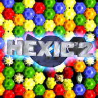

<div align=center>



</div>
<h1 align=center>hexic2-nx installer</h1>

The installer page of [hexic2-nx](https://github.com/ChanseyIsTheBest/hexic2-nx), the native Nintendo Switch port of
Hexic 2 (Xbox 360): **https://chanseyisthebest.github.io/hexic2-nx-installer/**

You give it your own copy of the game and its Title Update 1 (each as its Xbox 360 package, or a folder you extracted it into),
and it gives you a zip ready to extract into `sdmc:/switch/`. Everything runs in your browser: the game files never leave your
computer.

## What it does

1. Finds your files in what you chose, in any number of choices: the game's package (`Content/<profile>/58410826/000D0000`, read
   in place by `lib/stfs.js`; nothing is extracted to disk) or a folder with `default.xex`; and Title Update 1's package
   (`Content/0000000000000000/58410826/000B0000`, content type `0x000B0000`) or a folder with `default.xexp`.
2. Identifies the game by the SHA-256 of `default.xex` and picks its build from `release/manifest.json`, then checks the title
   update by the SHA-256 of `default.xexp`. Without Title Update 1 no package is made: the program is compiled from the update's
   code.
3. Downloads that build's NRO and checks its SHA-256.
4. Makes the shaders of the deko3d renderer. The game keeps them in three places: 32 Direct3D shader containers in the executable, which is decrypted and unpacked in the page
   (`lib/xex.js`, with libmspack's LZX decoder in WebAssembly) with the title update applied as the console does (`lib/xexp.js`); 50 in
   its shader files; and 149 in its mesh files, whose two parts of each container are stored apart: the page joins them as the game
   does when it registers a shader. The build's entry lists each one's file, offsets and SHA-256. The other 4 are in none of the
   game's files, so those 4 are built into the NRO. Each container goes through hexic2-nx's native chain: Renut's XenosRecomp
   translates it to HLSL (`wasm/renut_hlsl`), the alpha-tested pixel shaders get their early alpha copy (`lib/early_alpha.js`), DXC
   compiles it to SPIR-V (`wasm/dxc_web`), SPIRV-Cross turns that into GLSL (`wasm/spirv_cross`), banjo-nx's passes trim it
   (`lib/deko3d_glsl.js`) and `lib/deko3d_package.js` packs them. The package must match the tested one (its SHA-256 is in
   `release/manifest.json`). The console compiles each shader with uam the first time the game uses it and keeps the result.
5. Streams the zip to disk through the service worker.

The zip holds `hexic2-nx/hexic2-nx.nro` with its `LICENSES.txt`, `deko3d_glsl.bin` and the game in `game_root/` with the title
update's `default.xexp` beside `default.xex` (the console applies it at start). The update zip holds the NRO, its licenses, the
shaders and the title update. Neither holds `hexic2.toml`: the game writes it at its first start, so an update never overwrites your
settings.

The page and the downloaded program are cached by the service worker: after the first visit it also works without a connection.

## Layout

| Path | Contents |
|---|---|
| `index.html`, `app.js` | The page and its interface (English and Japanese, `lib/i18n.js`) |
| `worker.js` | Builds the package off the main thread |
| `sw.js` | Offline cache and the download stream |
| `lib/` | Package reader (STFS), XEX reader, title update (`xexp.js`), the deko3d shaders (`shaders.js`, `deko3d.js`, `early_alpha.js`, `deko3d_glsl.js`, `deko3d_package.js`), zip writer |
| `wasm/` | WebAssembly builds of the shader translator, DXC, SPIRV-Cross and the LZX decoders |
| `renut_shader_common.h` | Renut's translator's HLSL header (from `app/thirdparty/reblue-XenosRecomp/XenosRecomp` of hexic2-nx) |
| `release/` | The list of builds and the licenses of the NRO |
| `test/` | Node scripts that run the same code as the page |

`wasm/renut_hlsl.*` (Renut's translator, built from hexic2-nx's own tree with its `tools/renut_hlsl_frontend.cpp`) and
`wasm/spirv_cross.*` are built with `wasm/src/deko3d/build_wasm_deko3d.sh` (`KATAMARI_NX` names the hexic2-nx checkout). The translator
compiles in hexic2-nx's `shader_common.h`, so it must be rebuilt when that changes. `wasm/dxc_web.*` is the WebAssembly DXC of
[nfsmw-nx-installer](https://github.com/StevensND/nfsmw-nx-installer); see [NOTICES.md](NOTICES.md).

## Deployment

The NRO is not stored here: it is the `hexic2-nx.nro` asset of a release of the hexic2-nx repository of the same owner. The workflow in
`.github/workflows/deploy.yml` downloads it from the latest release, checks its SHA-256 against the list and publishes the page on
GitHub Pages. It runs on every push to `main`; after publishing a new release, run it by hand from the Actions tab.

To publish a new build, this script writes the build's entry in `release/manifest.json` from your own copy of the game, with the
page's code. The last file comes from hexic2-nx's `tools/hexic_shader_files.py`:

```sh
node test/release_node.mjs <game package or folder> <title update package or folder> <hexic2-nx.nro> <hexic_shader_files.json> --version 1.0.0 --write
```

It leaves the page's `deko3d_glsl.bin` in `release/` (not committed): test the NRO with exactly that file next to it.

## Testing locally

Put `hexic2-nx.nro` in `release/` and serve the folder (any static server works; this one sets the right MIME types):

```sh
python serve.py 8193
```

Then open http://127.0.0.1:8193/. The same code runs in Node:

```sh
node test/package_node.mjs hexic2-nx.zip <game package or folder> <title update package or folder>
node test/package_node.mjs hexic2-nx-update.zip <game package or folder> <title update package or folder> --update
node test/deko3d_node.mjs <game package or folder> <title update package or folder> [<the port's glsl_opt>] [--places <hexic_shader_files.json>] [--out deko3d_glsl.bin]
node test/texts_node.mjs
```

The two folders must be chosen apart from each other in the page: in Node, give their package files, or folders whose names differ below a common parent.

## License

GPL-3.0 (see [LICENSE](LICENSE)). Third-party components are listed in [NOTICES.md](NOTICES.md). The page is built on
[pacman-nx-installer](https://github.com/ChanseyIsTheBest/pacman-nx-installer) and
[katamari-nx-installer](https://github.com/ChanseyIsTheBest/katamari-nx-installer), themselves built on
[futari-nx-installer](https://github.com/ChanseyIsTheBest/futari-nx-installer),
[sa2-nx-installer](https://github.com/ChanseyIsTheBest/sa2-nx-installer) and
[nfsmw-nx-installer](https://github.com/StevensND/nfsmw-nx-installer) by StevensND.

Hexic 2 was developed by Carbonated Games and published by Microsoft; the icon artwork belongs to its owners. This project is not
affiliated with or endorsed by Microsoft or Nintendo.
